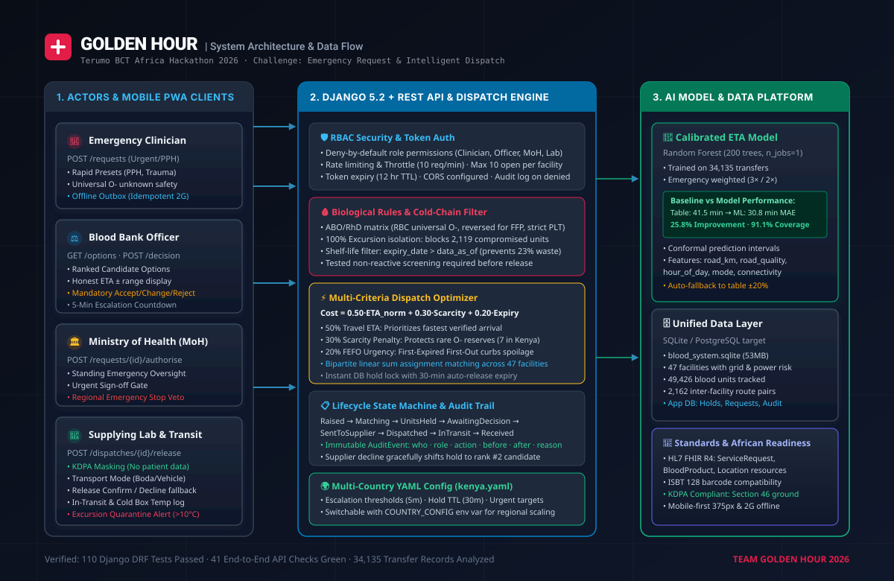

# Golden Hour: ranks safe, compatible blood across 47 facilities by honest arrival time, and keeps a person in control

Terumo BCT Africa Hackathon 2026 · Challenge area: Emergency request and dispatch


---

## 1. The problem

**The users.** A clinician at a hospital that has run out of blood, and the blood bank officer who must find compatible units for them. Today the officer phones the regional centre, then other centres, to find units, check they are safe, and guess when they will arrive.

**What the data shows.** All figures come from the synthetic starter dataset (one year, 47 facilities, modelled on Kenya).

- **Slow resupply.** An emergency resupply takes a median of about 5 hours (dataset README).
- **Unmet need.** Of 8,768 emergency requests, 726 (8.3%) were not fully met: 625 (7.1%) were not fulfilled and 101 were partly fulfilled. Of those 726, 240 were road traffic trauma and 238 were obstetric haemorrhage.
- **A table that is too optimistic.** The fixed route table (`routes.typical_travel_hours`) is off by 41.5 minutes on average for emergency transfers in our test set (see "AI and data").
- **Waste.** About 23% of red cell and whole blood units were wasted, meaning expired or discarded (dataset README).
- **Cold chain.** 2,119 units were transfused after a fridge or cool box had gone out of range (dataset README). 111 units still in stock carry the same temperature-excursion flag.
- **Rare group.** Only 7 safe O− red cell units were in stock across all 47 facilities on 31 October 2026. Of 305 O− red cell requests in the year, 132 (43.3%) were not fully met. This is why the ranking adds a penalty for using up a scarce group.

The approval steps, the audit trail and the data-protection notes follow what we heard in the Tuesday 15:00 blood-service Q&A.

---

## 2. What we built

Golden Hour takes one emergency request from raised to received: match, rank, decide, authorise, release, deliver, confirm. Fixed rules decide what is safe and compatible. A model estimates arrival time. People make every decision that moves blood.

### What works now

Everything here runs end to end on the starter dataset and is covered by tests (see "How to run it").

1. **Compatibility rules (fixed code, no AI).** ABO and RhD tables for red cells, reversed rules for plasma, strict rules for platelets. If the patient group is unknown, red cells default to O− and plasma to group AB, with a warning. Platelets are refused until the patient is grouped.
2. **Safe-unit filter.** A unit is offered only if it is in stock, has no temperature-excursion flag, has not expired (against the data date, 31 October 2026), comes from a donation screened non-reactive, and is not already held for another request.
3. **Ranking.** The 12 nearest sites by route table go to the ranking function, and the best 3 are shown. Score = 0.50 x arrival time + 0.30 x scarcity + 0.20 x expiry, where lower is better. Arrival time is divided by the 95th percentile of historical transfer times. Scarcity penalises using up a rare group. Expiry favours units that expire sooner (first-expired, first-out).
4. **Arrival time with a range.** A Random Forest gives low, middle and high minutes for each site.
5. **Human gate.** The blood bank officer chooses Accept, Change (with a reason) or Reject (with a reason). Life-threatening requests go ahead under the Ministry of Health's standing authorisation when `config/kenya.yaml` says so, and the MoH officer is notified. Other requests wait for the MoH officer's approval. The MoH officer can also stop a transfer before release. The supplying lab officer confirms or declines the release. The clinician confirms arrival and the cool-box temperature. Above 10 °C the units are flagged for quarantine.
6. **Safeguards.** The top site's units are held at once. A hold that waits longer than 30 minutes for a decision or approval is released and the request is marked for phone handling. If a supplier declines, the next site is held and the request goes back to the officer. A repeated `client_request_id` returns the original request instead of raising a second one.
7. **Audit trail.** Every step writes an event: who, role, action, before, after, reason, time. The log is append-only in the application code. It has its own page and a timeline on each request.
8. **Supplier-safe view.** The supplying lab never receives the patient's blood group or clinical note.
9. **Screens.** A landing page, sign-in, and a workspace for each of the 4 roles: overview, requests table, request detail, decisions, approvals, orders, arrivals. The two main flows were also run in a browser at 375 px width.

### What is mocked or not finished

- **Readiness page:** it shows sample figures and says so on the page. There is no live endpoint behind it.
- **Offline support:** the clinician screen sends new requests through a tested outbox (`frontend/src/offline/`) with safe retries. If the server cannot be reached, the request is kept on this device, marked NOT SENT with a plain "call the blood bank" message, and retried when the connection returns. The connection dot reflects whether the server really answers. Stock and options are not cached.
- **SMS and USSD:** not built.
- **Escalation to a backup officer:** the decision screen shows the 5-minute timer from the config, but nothing escalates automatically. The only timer the server enforces is the 30-minute hold expiry.
- **Standards:** FHIR, ISBT 128 and DHIS2 are mapped on paper only. Nothing is exported. See `docs/fhir-mapping.md`.
- **Live stock:** stock is the static dataset snapshot of 31 October 2026, plus the holds made in the app.
- **Hosting:** there is no deployed instance.

- **Demo video (3 minutes or less):** https://drive.google.com/file/d/1c_fuNwKFBfdjIadU25gHUMRwuryUeXUc/view?usp=sharing
- **Live demo:** none deployed. It runs locally, see How to run.

**Test log-ins** (all synthetic). The sign-in page also has "Sign in as a test user" buttons. The password is `demo2026` for every account.

| Role | Email |
|---|---|
| Clinician | `clinician@goldenhour.health` |
| Blood bank officer | `officer@goldenhour.health` |
| Backup officer | `backup.officer@goldenhour.health` |
| Ministry of Health | `moh@goldenhour.health` |
| Supplying lab | `lab@goldenhour.health`, or `lab.<facility_id>@goldenhour.health` for one site (for example `lab.hsp-001@goldenhour.health`) |

---

## 3. How to run it

The slow step is `pip install`, which downloads numpy, pandas and scikit-learn.

**You need:** Python 3.11 or newer, Node.js 18 or newer, and Git.

**1. Backend (Django and Django REST Framework)**

```bash
git clone https://github.com/IanOchiengAI/golden-hour.git
cd golden-hour/backend
python -m venv .venv
# Windows PowerShell:  .\.venv\Scripts\Activate.ps1
# Linux or macOS:      source .venv/bin/activate
pip install -r requirements.txt
python manage.py migrate
python manage.py seed_demo_users
python manage.py runserver 8000
```

The starter database (`blood_system.sqlite`) is in the repository, so there is nothing to build. The first request after start-up can take several seconds while the model loads.

**2. Frontend (React, Vite, Tailwind)**, in a second terminal:

```bash
cd golden-hour/frontend
npm install
npm run dev
```

Open `http://localhost:5173`. The dev server forwards API calls to port 8000.

**3. Tests**

```bash
cd golden-hour/backend && python manage.py test        # 110 backend tests
cd .. && python docs/e2e_test.py                        # 25 checks through the whole flow, needs the backend running
python backend/scripts/try_flow.py --urgency life_threatening   # walks one request from raised to received
cd frontend && node --experimental-strip-types --test tests/offline/   # offline helper tests, Node 22.6 or newer
```

---

## 4. Architecture



**Main parts.** React screens call a Django REST API with a login token. The API runs the fixed rules, asks the ETA model for arrival times, ranks the sites, holds units, and writes an audit event for every step. The starter dataset is opened read-only. The app's own database holds users, requests, ranked options, holds, dispatches and the audit log. Country rules are read from `config/kenya.yaml`.

**Data flow.** Clinician request, rules and safe-unit filter, ETA model (or route table), ranking, auto-hold, officer decision, authorisation, lab release, in transit, received. Each step is an audit event.

**Where this sits in a wider blood-bank information system.** This prototype covers emergency request and dispatch, between distribution and the hospital transfusion service. The diagram shows the neighbouring modules (donor management, collection and testing, processing and inventory, cold-chain monitoring, reporting). In this prototype the starter dataset stands in for them. Links to real systems are drawn dashed and marked "future".

**Standards.** FHIR R4, ISBT 128 and DHIS2 are mapped on paper in `docs/fhir-mapping.md`, with each item labelled implemented, mapped on paper or future. Nothing is implemented today. The data model is in `docs/data-model.md`.

---

## 5. AI and data

- **What the feature does:** estimates how long blood will take to travel from each supplying site to the requesting hospital, as a range (low, middle, high minutes), and uses it to rank sites.
- **Baseline we compared against:** the fixed route table, `routes.typical_travel_hours`.

**Result.** Trained on 34,135 clean transfers from the one synthetic year, split 60 / 20 / 20 into train, calibrate and test. There is no later test period.

| Measure | Route table | Golden Hour | Change |
|---|---|---|---|
| Mean absolute error, emergency transfers | 41.5 min | 30.8 min | 25.8% lower |
| Mean absolute error, all transfers | 18.3 min | 14.5 min | 20.7% lower |
| Real trips inside the stated range, emergency and urgent | not applicable | 91.1% | target of 90% met |
| Real trips inside the stated range, all transfers | not applicable | 96.2% | |

Source: `docs/ian-numbers.md`. We evaluated the arrival-time model. We have not yet replayed the whole ranking against "nearest site first".

- **How a user sees the reason:** each option shows one plain sentence with the arrival range, road distance and quality, units available and expiry date, plus warnings for a rare group, partial stock or a low-reliability power grid.
- **Who approves:** the blood bank officer (Accept, Change, Reject), then the MoH officer where required, then the supplying lab officer. The model never releases a unit and never decides compatibility.
- **If the AI is wrong or offline:** the system uses the route table plus or minus 20% and marks the request `fallback`. The officer sees an "AI offline" banner. The rules, holds and approvals work the same without the model.

**How the model works.** Random Forest regressor (scikit-learn 1.9.1, 200 trees). Emergency transfers count 3 times and urgent ones 2 times in training. Features: road distance, road quality, transport mode, hour of day, day of week, and the destination's mobile connectivity. No patient or donor data is used. The ranges come from conformal calibration on about 1,028 held-out emergency and urgent transfers. The model was trained with transport mode, and the lab records the mode, but the ranking predicts for a vehicle. No large language model runs inside the product.

---

## 6. Data

All data is synthetic and comes from the hackathon's starter dataset. We added no other data. No real donor, patient or facility records are used.

| Table | Used for |
|---|---|
| `facilities` | Names, types, grid reliability, connectivity |
| `routes` | Road distance, road quality, route-table times (baseline and fallback) |
| `units` | Stock, expiry, blood group, temperature-excursion flag |
| `donations` | Screening result and test date (a unit needs a non-reactive result) |
| `transfers` | Training the arrival-time model only |
| `requests` | Training the arrival-time model only (urgency weights), and the figures in section 1 |

The other starter tables are not used. The app reads the starter data read-only and treats 31 October 2026 as "today". Details are in `docs/data-model.md`.

---

## 7. African conditions

| Condition | What we did | What is not done |
|---|---|---|
| Slow connection | Small app: JavaScript 317 kB (93 kB compressed), CSS 26 kB (6 kB compressed), measured from `npm run build`. Screens refresh every 10 seconds and show a plain error when the server cannot be reached. New requests are kept in an outbox on the device when the server is unreachable and retried with the same `client_request_id`, so a retry never raises a second request. | Only raising a request is queued. There is no service worker, so the app does not load without a connection. Browser storage is plain localStorage (no IndexedDB). |
| Weak power | The officer sees a warning when the supplying site's grid reliability is below 75%. The receiving clinician records the cool-box temperature, and above 10 °C the units are flagged for quarantine. | Grid reliability is a warning only. It does not change the ranking. |
| Basic phones | The two main flows were run in a browser at 375 px width. | Not tried on a real phone or a real 2G link. |
| Languages | English. | No translation yet. |
| Another site or country | Country rules sit in one YAML file chosen with the `COUNTRY_CONFIG` environment variable: the data date, the approval route, timers, limits and which facility types may supply. | `config/kenya.yaml` is the default. `config/uganda.yaml` is a sample second country: with it the same code gives 2 options instead of 3, approval before dispatch instead of standing authorisation, and a quarantine warning at a 9 °C cool box (limit 8 °C instead of 10 °C). Steps are in `config/README.md`. The clinician form still allows up to 10 units, while the Uganda sample limit is 6. There is no blood-group prevalence setting, and blood-group rules are code. Escalation timers are shown but not enforced. |
| Existing systems | Data model and standards mapping on paper. | No integration yet. |

---

## 8. Security and data protection

This is a prototype on synthetic data. This design is KDPA-aware (it limits who sees what, keeps a record, and protects health data). It is not a compliance claim. The Tuesday Q&A checklist is the outline for the pilot path.

**What exists today**

- Synthetic data only.
- Deny-by-default roles with facility scoping. Clinicians see only their own hospital's requests. Labs see only dispatches from their own site.
- The lab view uses a fixed list of fields with no patient blood group or note.
- Login token that expires after 12 hours. Login limited to 10 a minute.
- Raising requests limited to 10 a minute, and 10 open requests per facility.
- Holds expire after 30 minutes. A repeated `client_request_id` cannot raise a second request.
- Input validation on the endpoints. Secrets come from environment variables. HTTPS settings turn on when `DJANGO_DEBUG=0`.
- Append-only audit log (append-only in the application code; not tamper-proof).
- Bandit static scan, run on 11 Nov on `backend/` and `ml/`: no High issues, and no issues in the backend application code. It flags the two test files that contain a test password (Low), and in `ml/` that the arrival-time model is read with `pickle` from a file in the repository, not from user input (1 Medium, 2 Low). A pilot would load the model only from a trusted, checksum-checked location. OWASP ZAP has not been run.
- 110 backend tests.

**Pilot pathway (not built)**

- Data protection impact assessment.
- Registration with the Office of the Data Protection Commissioner.
- Processor agreements with hosting and SMS providers.
- Privacy notice and consent log.
- Incident response plan. The legal reporting windows must be checked against the Act.
- A map of where data is hosted and whether it leaves the country.
- Encryption at rest.
- Rights-request workflow.
- Bias testing of the ranking.
- PostgreSQL in place of SQLite.
- Approved SMS templates.
- Tamper-evident audit log.

More detail is in `docs/security.md`.

---

## 9. AI tools we used

Each entry is in the member's own words.

- **Ian Ochieng:** Google Antigravity (Gemini). Data exploration, cleaning the transfer data, training and tuning the arrival-time model, conformal prediction intervals, the ranking algorithm, ML code review, the end-to-end test script and the numbers document.
- **Joronimo Amanya:** Google Antigravity with Gemini 4 Argon. Fitting the user interface to the architecture.
- **Roland Sankara:** Claude Opus 5.5 (Anthropic): planning, and Claude Code as coding assistant.
- **Daniel Bitengo:** Claude Code (Claude Sonnet 5.5, Anthropic). Reviewing the backend, running end-to-end and browser tests, writing the data model and security documentation, building and wiring the offline outbox (`frontend/src/offline`), and checking this README against the code. Daniel checked everything against the code.

No large language model runs inside the product.

---

## 6. Data

All data is synthetic and comes from the hackathon's starter dataset. We added no other data. No real donor, patient or facility records are used.

| Table | Used for |
|---|---|
| `facilities` | Names, types, grid reliability, connectivity |
| `routes` | Road distance, road quality, route-table times (baseline and fallback) |
| `units` | Stock, expiry, blood group, temperature-excursion flag |
| `donations` | Screening result and test date (a unit needs a non-reactive result) |
| `transfers` | Training the arrival-time model only |
| `requests` | Training the arrival-time model only (urgency weights), and the figures in section 1 |

The other starter tables are not used. The app reads the starter data read-only and treats 31 October 2026 as "today". Details are in `docs/data-model.md`.

---

## 7. African conditions

| Condition | What we did | What is not done |
|---|---|---|
| Slow connection | Small app: JavaScript 317 kB (93 kB compressed), CSS 26 kB (6 kB compressed), measured from `npm run build`. Screens refresh every 10 seconds and show a plain error when the server cannot be reached. New requests are kept in an outbox on the device when the server is unreachable and retried with the same `client_request_id`, so a retry never raises a second request. | Only raising a request is queued. There is no service worker, so the app does not load without a connection. Browser storage is plain localStorage (no IndexedDB). |
| Weak power | The officer sees a warning when the supplying site's grid reliability is below 75%. The receiving clinician records the cool-box temperature, and above 10 °C the units are flagged for quarantine. | Grid reliability is a warning only. It does not change the ranking. |
| Basic phones | The two main flows were run in a browser at 375 px width. | Not tried on a real phone or a real 2G link. |
| Languages | English. | No translation yet. |
| Another site or country | Country rules sit in one YAML file chosen with the `COUNTRY_CONFIG` environment variable: the data date, the approval route, timers, limits and which facility types may supply. | `config/kenya.yaml` is the default. `config/uganda.yaml` is a sample second country: with it the same code gives 2 options instead of 3, approval before dispatch instead of standing authorisation, and a quarantine warning at a 9 °C cool box (limit 8 °C instead of 10 °C). Steps are in `config/README.md`. The clinician form still allows up to 10 units, while the Uganda sample limit is 6. There is no blood-group prevalence setting, and blood-group rules are code. Escalation timers are shown but not enforced. |
| Existing systems | Data model and standards mapping on paper. | No integration yet. |

---

## 8. Security and data protection

This is a prototype on synthetic data. This design is KDPA-aware (it limits who sees what, keeps a record, and protects health data). It is not a compliance claim. The Tuesday Q&A checklist is the outline for the pilot path.

**What exists today**

- Synthetic data only.
- Deny-by-default roles with facility scoping. Clinicians see only their own hospital's requests. Labs see only dispatches from their own site.
- The lab view uses a fixed list of fields with no patient blood group or note.
- Login token that expires after 12 hours. Login limited to 10 a minute.
- Raising requests limited to 10 a minute, and 10 open requests per facility.
- Holds expire after 30 minutes. A repeated `client_request_id` cannot raise a second request.
- Input validation on the endpoints. Secrets come from environment variables. HTTPS settings turn on when `DJANGO_DEBUG=0`.
- Append-only audit log (append-only in the application code; not tamper-proof).
- Bandit static scan, run on 11 Nov on `backend/` and `ml/`: no High issues, and no issues in the backend application code. It flags the two test files that contain a test password (Low), and in `ml/` that the arrival-time model is read with `pickle` from a file in the repository, not from user input (1 Medium, 2 Low). A pilot would load the model only from a trusted, checksum-checked location. OWASP ZAP has not been run.
- 110 backend tests.

**Pilot pathway (not built)**

- Data protection impact assessment.
- Registration with the Office of the Data Protection Commissioner.
- Processor agreements with hosting and SMS providers.
- Privacy notice and consent log.
- Incident response plan. The legal reporting windows must be checked against the Act.
- A map of where data is hosted and whether it leaves the country.
- Encryption at rest.
- Rights-request workflow.
- Bias testing of the ranking.
- PostgreSQL in place of SQLite.
- Approved SMS templates.
- Tamper-evident audit log.

More detail is in `docs/security.md`.

---

## 9. AI tools we used

Entries for teammates are to be confirmed by each member before submission.

- **Google Antigravity and Gemini 3.8** (to be confirmed by each member): code scaffolding, architecture refinement, exploratory data analysis scripts.
- **Claude Sonnet 4.6, Anthropic** (to be confirmed by each member): Django REST Framework views, tests and React components.
- **Claude Code (Claude Sonnet 5.5, Anthropic), used by Daniel Bitengo to review the backend, run end-to-end and browser tests, write the data model and security documentation, build and test the offline helper library (frontend/src/offline), and check this README against the code. Daniel checked everything against the code.**

No large language model runs inside the product. The arrival-time model is a scikit-learn Random Forest.

---

## 10. Team

| Name | Role | Country | Presenting Friday |
|---|---|---|---|
| Ian Ochieng | AI and algorithm architect | Kenya | In person (Nairobi) |
| Joronimo Amanya | Frontend | Uganda | Online |
| Roland Sankara | Team Lead, Backend Lead | Uganda | Online |
| Daniel Bitengo | Architecture, documentation, testing | Kenya | In person (Nairobi) |

---

## 11. Known limits and next steps

1. **Wide ranges on short routes.** The range is honest but can be broad. Calibrating it by distance would narrow it.
2. **Model test is from the same year.** The test data is from the same synthetic year. We have not tested on a later period.
3. **One supplying site per request.** If no site has enough units, the option is marked partial. Splitting a request across sites is not built.
4. **Static stock.** There is no live stock feed. Delivered units stay listed in the starter data, so the app keeps them out of matching.
5. **Audit log.** Append-only in the application code. Not tamper-proof.
6. **Not built:** SMS and USSD, automatic escalation, a live readiness endpoint, FHIR export, other languages, deployment, an OWASP ZAP scan.
7. **Next:** replay the ranking against "nearest site first", narrow the ranges by distance, move to PostgreSQL, and work through the pilot checklist in `docs/security.md`.
