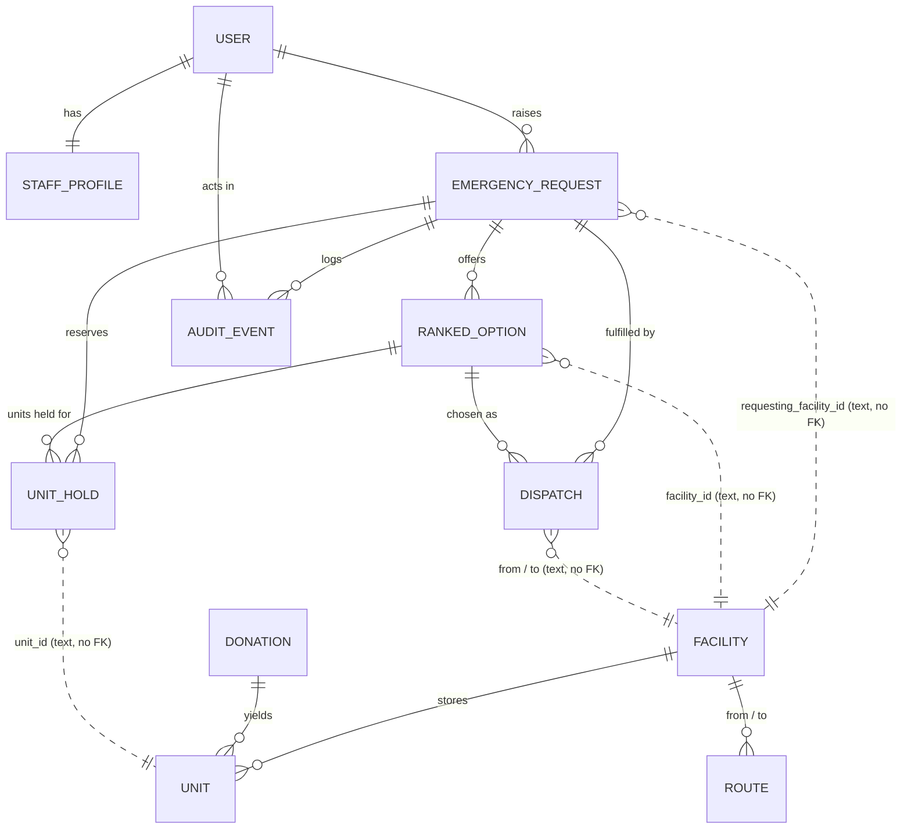

# Data model

> Built from the code on `ft/backend` at commit `ea4e05e` (10 Nov, 22:41 EAT), not from the plan.
> The FHIR, ISBT 128 and DHIS2 mapping is a separate step (see the last section).

All data is synthetic. Times are stored with a timezone and shown in East Africa Time (UTC+3).

## 1. Two data stores

| Store | File | Access | Holds |
|---|---|---|---|
| Starter data | `Terumo BCT Hackathon - Applicant_s Kit/Starter Dataset/blood_system.sqlite` | Read-only (`emergency/stock.py` opens it with `mode=ro`) | Facilities, routes, units, donations. The provided dataset, never modified. |
| App data | `backend/app.sqlite3` (Django ORM) | Read and write | Users, requests, ranked options, unit holds, dispatches, audit log |

The two stores are joined by plain text ids (`facility_id`, `unit_id`). There are no foreign keys across them, so the database cannot check that an id exists on the other side. The code checks facility ids when a request is raised.

## 2. App data (what the workflow writes)

### StaffProfile (`accounts`)
One role per user, plus the facility they work at. Extends Django's `User`; login uses a DRF token that expires after 12 hours (`TOKEN_TTL_HOURS`). An expired token is refused, deleted and audited.

| Field | Type | Notes |
|---|---|---|
| user | one-to-one User | |
| role | text | `clinician`, `blood_bank_officer`, `moh_officer`, `lab_officer` |
| facility_id | text | A starter-data `facility_id`. Empty for MoH. |
| phone | text | For SMS (not used yet) |

### EmergencyRequest
A clinician's request for blood. **The only table that holds patient fields.**

| Field | Type | Notes |
|---|---|---|
| requesting_facility_id | text | From the clinician's profile, never from the request body |
| raised_by | FK User (protect) | |
| client_request_id | text (64), null | Optional idempotency key from the client (for example a UUID from the offline outbox). The same user sending the same id again gets the original request back. |
| patient_blood_group | text | `O-` `O+` `A-` `A+` `B-` `B+` `AB-` `AB+` or `unknown` |
| component | text | `RBC`, `PLT`, `FFP` |
| units_requested | small int | 1 to `max_units_per_request` (10, from config) |
| urgency | text | `life_threatening`, `urgent`, `routine` |
| clinical_note | text (500) | Patient-related free text |
| status | text | One of 12 values, listed below the table |
| status_changed_at | datetime | Start of the current status; timers measure from here |
| compatible_groups | JSON list | Donor groups the rules engine allowed, fixed at creation |
| warnings | JSON list | For example the unknown-group warning |
| eta_method | text | `model` or `fallback`, drives the "AI offline" banner |
| authorisation_route | text | `standing` or `per_transfer`, set when the officer accepts |
| escalated_at | datetime, null | **Not written by any code yet** |
| created_at, updated_at | datetime | |

**Status values:** `Raised`, `Matching`, `UnitsHeld`, `AwaitingDecision`, `Escalated`, `AwaitingAuthorisation`, `SentToSupplier`, `Dispatched`, `InTransit`, `Received`, `HandledManually`, `DraftFromCall`.

The normal path is `Raised`, `Matching`, `UnitsHeld`, `AwaitingDecision`, then `SentToSupplier` (or `AwaitingAuthorisation` first, when the MoH must approve), `Dispatched`, `InTransit`, `Received`. `Matching`, `AwaitingDecision`, `AwaitingAuthorisation` and `SentToSupplier` can each end in `HandledManually`, a terminal state for requests a person must finish by phone. A request that waits longer than `hold_ttl_min` for the officer or the MoH has its holds released and moves to `HandledManually`. A supplier decline sends the request back to `UnitsHeld` and `AwaitingDecision` with the next-ranked site held. `Escalated` and `DraftFromCall` are in the lifecycle table but no code moves a request into them yet. The allowed moves are in `ALLOWED_TRANSITIONS` in `backend/emergency/services.py`.

### RankedOption
One supplying site offered to the officer. Saved at matching time, so reading options never re-runs matching.

| Field | Type | Notes |
|---|---|---|
| request | FK EmergencyRequest (cascade) | Unique together with `rank` |
| rank | small int | 1 = best |
| facility_id, facility_name | text | The supplying site |
| eta_low_min, eta_mid_min, eta_high_min | float | Arrival range in minutes |
| method | text | `model` or `fallback` |
| reason | text | Plain-language explanation shown to the officer |
| warnings | JSON list | For example rare group, low grid reliability, partial stock |
| units_available | int | Safe, compatible units at the site |
| is_partial | bool | Site has fewer units than requested |
| unit_ids | JSON list | Units the site would send, in pick order |
| blood_groups | JSON list | Groups of those units |

### UnitHold
A unit reserved for a request.

| Field | Type | Notes |
|---|---|---|
| request | FK EmergencyRequest (cascade) | |
| option | FK RankedOption (cascade) | |
| unit_id | text | A starter-data `unit_id` |
| facility_id | text | Where the unit sits |
| held_at | datetime | |
| released_at, release_reason | datetime, text | Set when the hold is given back |
| consumed_at | datetime, null | Set when the lab releases the unit. A consumed hold is never released, because the starter data still lists the unit as `in_stock`. |

Hold state is encoded in two nullable columns: **active** (both empty), **released** (`released_at` set), **consumed** (`consumed_at` set, `released_at` empty).

### Dispatch
One movement of units from a supplying site to the requesting hospital. The supplying lab sees this, never the patient fields.

| Field | Type | Notes |
|---|---|---|
| request | FK EmergencyRequest (protect) | |
| option | FK RankedOption (protect) | |
| from_facility_id, to_facility_id | text | |
| unit_ids | JSON list | Copy of the held units at creation |
| status | text | `AwaitingRelease`, `Released`, `Declined`, `Cancelled`, `InTransit`, `Received` |
| transport_mode | text | `vehicle`, `motorbike`, `public_service_vehicle` |
| released_by, released_at | FK User, datetime | The qualified lab officer |
| decline_reason | text (500) | |
| in_transit_at | datetime | |
| received_by, received_at | FK User, datetime | |
| coolbox_max_temp_c | float, null | Above the config limit (10 °C) the receiving lab is told to quarantine |
| created_at | datetime | |

### AuditEvent
Append-only record of every action: who, role, action, object, before, after, reason, time.

| Field | Type | Notes |
|---|---|---|
| request | FK EmergencyRequest (protect), null | Null for logins and denied access |
| actor | FK User (set null), null | |
| actor_username | text | Kept even if the user is removed |
| actor_role | text | `system` for automatic steps |
| action | text (64) | Free text. 24 values are used today, listed below the table. |
| object_type, object_id | text | For example `dispatch`, `12` |
| before, after | JSON, null | |
| reason | text | |
| created_at | datetime | Indexed |

**Actions in use:** `request_raised`, `status_changed`, `matching_completed`, `units_held`, `hold_conflict_retry`, `holds_released`, `decision_accepted`, `decision_changed`, `decision_rejected`, `dispatch_created`, `moh_notified`, `authorisation_approved`, `authorisation_rejected`, `authorisation_stopped`, `authorisation_reviewed`, `release_confirmed`, `release_declined`, `cold_chain_excursion_on_arrival`, `hold_expired`, `request_refused_cap`, `login`, `login_failed`, `token_expired`, `access_denied`.

Append-only is enforced in application code (`save` and `delete` are overridden). A bulk `update()` or `delete()` on the queryset would bypass it.

## 3. Starter data the workflow reads

| Table | Columns the code uses | Used by |
|---|---|---|
| facilities | facility_id, name, facility_type, county, grid_reliability, connectivity, has_blood_fridge_backup_power | Matching, ranking warnings, screens |
| routes | from_facility_id, to_facility_id, road_km, typical_travel_hours, road_quality | Shortlist, ETA model, fallback ETA |
| units | unit_id, component, blood_group, expiry_date, status, temp_excursion_exposed, current_facility_id, donation_id | Rules engine (safe-unit filter) |
| donations | donation_id, screening_result, tested_date | Rules engine (a unit needs a non-reactive result and a test date) |
| transfers | dispatched_at, received_at, transport_mode, request_id, plus routes and facilities | ETA model **training only** (`ml/train_eta.py`) |
| requests | request_id, urgency | ETA model **training only** (`ml/train_eta.py`): emergency transfers are weighted 3 times and urgent ones 2 times |

Not used by the live workflow: `daily_stock`, `temperature_logs`, `power_outages`, `donors`, `drives`.

## 4. Relationships

Solid lines are database foreign keys. Dotted lines are text ids that cross the two stores.

## 5. Rules the database enforces

| Constraint | Effect |
|---|---|
| `uniq_option_rank` (request, rank) | One option per rank per request |
| `one_active_hold_per_unit` (unit_id, only while `released_at` is empty) | Two requests can never hold the same unit |
| `one_open_dispatch_per_request` (request, only while status is AwaitingRelease, Released or InTransit) | At most one dispatch in progress per request |
| `one_request_per_client_id_per_user` (raised_by, client_request_id, only when the id is set) | A retried request cannot create a second request |
| Foreign keys with protect on request, option and audit | A request that has options, dispatches or audit rows cannot be deleted by accident |

## 6. Who sees what

**Patient fields** are `patient_blood_group` and `clinical_note` on `EmergencyRequest`. The audit trail also carries the patient group (in `request_raised`). Supplying labs never receive them.

| Data | Clinician | Blood bank officer | MoH officer | Supplying lab officer |
|---|---|---|---|---|
| Requests with patient fields (`GET /requests`, `GET /requests/{id}`) | Own hospital only. Another hospital's request returns 404. | All requests | All requests | No (403) |
| Ranked options (`GET /requests/{id}/options`, and inside request detail) | Inside request detail, own hospital only | Yes | Inside request detail | No |
| Decide: accept, change, reject | No | Yes, on any request | No | No |
| Authorise: approve, reject, stop, review | No | No | Yes | No |
| Dispatch list and detail (`GET /dispatches`) | Dispatches to own hospital | No endpoint | No endpoint (sees the dispatch inside request detail) | Dispatches from own site |
| Release or decline | No | No | No | Only at the supplying site |
| Mark in transit | No | No | No | Only at the supplying site |
| Confirm receipt | Only at the requesting hospital | No | No | No |
| Audit trail (`GET /audit`) | No | Yes | Yes | No |

Dispatch responses carry a fixed list of supplier-safe fields (`SUPPLIER_SAFE_DISPATCH_FIELDS` in `backend/emergency/serializers.py`). No patient field is in it.

**Staff data** (username, role, facility, phone) lives in `User` and `StaffProfile`. Login returns the caller's own username, role, facility and token expiry time. Everything else is visible through the Django admin only.

**The ETA model and ranker** receive facility, unit group, expiry date, stock counts and grid reliability. They receive no patient fields. The patient group is used only by the rules engine, which is fixed code.

**Open questions for the backend owner:**
- Officer actions are not scoped to a facility, so any blood bank officer can open or decide any request.
- The MoH officer sees `clinical_note` and the patient group on every request. If the MoH only needs urgency and the dispatch, a reduced view would follow the "share each stakeholder only what they need" guidance.

## 7. Country rules (`config/kenya.yaml`)

Rules that differ by country sit in a YAML file, not in code. The file is chosen with the `COUNTRY_CONFIG` environment variable. It is read once per process, so a change needs a restart. `kenya.yaml` is the default; `config/uganda.yaml` is a sample second country (see `config/README.md`).

| Key | Read by code today | Effect |
|---|---|---|
| `data_as_of` | Yes | The dataset's "today" for expiry checks and ranking |
| `emergency_authorisation` | Yes | `standing`: life-threatening requests proceed under the MoH standing authorisation. `per_transfer`: the MoH approves each transfer. |
| `options_count` | Yes | Ranked sites shown to the officer |
| `ranking_shortlist` | Yes | Nearest sites sent to the ETA model |
| `supplying_facility_types` | Yes | Facility types allowed to send blood |
| `max_units_per_request` | Yes | Input limit |
| `coolbox_max_temp_c` | Yes | Above this on receipt, the units are flagged for quarantine |
| `hold_ttl_min` | Yes | Holds on a request still waiting for the officer or MoH are released after this many minutes, and the request moves to `HandledManually` |
| `max_open_requests_per_facility` | Yes | Most open requests one hospital can have. More are refused with 429 and audited as `request_refused_cap`. |
| `decision_escalation_min`, `authorisation_escalation_min` | Only to show a due time | No timer acts on them yet |
| `urgency_targets_min` | Checked at start-up only | No logic uses it yet |
| `country`, `country_code`, `timezone` | No | In the file for completeness; Django's time zone is set in its own settings |

## 8. Known gaps

- `RankedOption.unit_ids` and `Dispatch.unit_ids` are JSON lists, so "which request holds unit X" can only be answered through `UnitHold`.
- Nothing records that units arrived with a cool-box excursion beyond an audit event and a warning. There is no quarantine state on a unit.
- `EmergencyRequest.compatible_groups` is fixed when the request is created. If the lab later confirms an `unknown` patient group, nothing updates it.
- Hold expiry runs when someone raises a request, decides or authorises, or when `manage.py expire_holds` is run on a schedule. With no traffic and no schedule, a stale hold stays until the next call.

## 9. Standards mapping

Not started. FHIR, ISBT 128 and DHIS2 mappings will be added after checking resource names and fields against the official documentation. Each row will be labelled "implemented", "mapped on paper" or "future".
